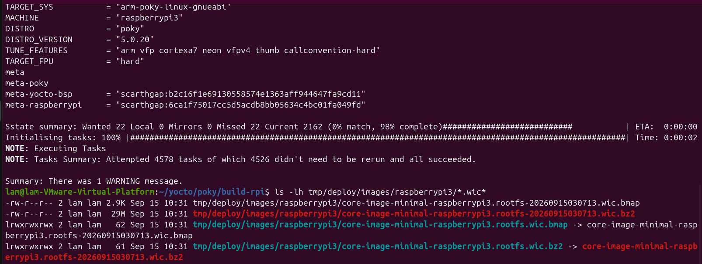

BÁO CÁO ĐỒ ÁN HỆ THỐNG NHÚNG - YOCTO PROJECT (Xác minh và Lưu trữ File Thành phẩm OS Image - TUẦN 5)

Tên đề tài: Biên dịch Hệ điều hành nhúng với Yocto Project trên môi trường RAS PI 3

Tên nhóm: Group 8

Giảng viên hướng dẫn: Thầy Huỳnh Hoàng Hà

Thành viên thực hiện:

1. Nguyễn Phúc Lộc - 24161109

2. Nguyễn Vũ Lâm - 24161105

3. Phan Thị Như Ý - 24161155

4. Nguyễn Văn Quý - 24161128

5. Trần Vạn Phước - 24161126
  
1. Kích hoạt môi trường làm việc cho Pi

cd ~/yocto/poky
source oe-init-build-env build-rpi 

2. Chỉnh sửa cấu hình bo mạch

nano conf/local.conf 

Tìm dòng chữ MACHINE (qemux86-64) và sửa lại chính xác thành: MACHINE = "raspberrypi3" 

3. Bắt đầu quá trình biên dịch

bitbake core-image-minimal

4. Kiểm tra
Lệnh ls -lh tmp/deploy/images/raspberrypi3/*.wic* được gõ để xác nhận và lấy file hệ điều hành (OS Image) thành phẩm sau khi biên dịch xong.

Ý nghĩa của các file hiển thị:
+ core-image-minimal-raspberrypi3.rootfs.wic.bz2 (29MB): Đây là bản nén của file hệ điều hành hoàn chỉnh (bao gồm Bootloader, Kernel Linux 6.6 và RootFS tối thiểu).

+ core-image-minimal-raspberrypi3.rootfs.wic.bmap: File bản đồ khối dữ liệu, dùng để hỗ trợ nạp hệ điều hành vào thẻ nhớ SD nhanh hơn.

# Cấu hình Build Yocto cho Raspberry Pi 3

- **Target Machine:** `raspberrypi3`
- **Yocto Release:** Scarthgap (5.0.20)
- **Kernel Version:** `linux-raspberrypi 6.6.63`
- **Trạng thái:** Biên dịch thành công 4578/4578 tasks
### Minh chứng kết quả build thành công Raspberry Pi 3

